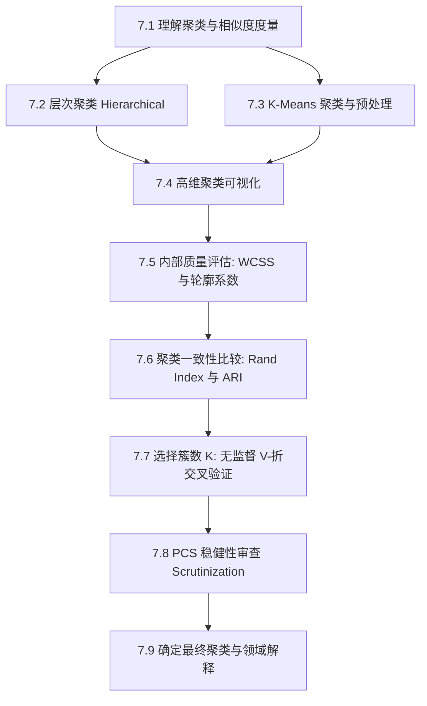

# 《可信数据科学》第 7 章：聚类分析（Clustering）系统学习笔记

> **原书出处**：Bin Yu & Rebecca L. Barter, *Veridical Data Science: The Practice of Responsible Data Analysis and Decision Making* (MIT Press, 2024), Part II — Chapter 7: Clustering  
> **在线原文**：https://vdsbook.com/  
> **学习目标**：深入掌握无监督聚类的数学原理、高维可视化与量化评估方法，重点理解如何用 **PCS（可预测性、可计算性、稳定性）框架** 审查聚类结果，避免“盲跑算法”的陷阱。

---

## 本章知识地图

---

## 7.1 理解聚类（Understanding Clusters）

### 1. 什么是聚类？
聚类（Clustering）是一种经典的**无监督学习（Unsupervised Learning）**方法：在**没有任何预先给定的类别标签（Ground Truth）**的情况下，完全依据数据本身的特征分布，将观测样本划分为若干个“同质化子群（Clusters）”。

* **原书贯穿案例**：USDA 食物营养数据库（FNDDS）。传统营养学靠人工将食物分为谷物、蔬菜、肉类、乳制品等大类；聚类则试图直接从几十种营养成分（蛋白质、脂肪、碳水、钠、维生素等）出发，让数据自己“说出”哪些食物在营养结构上最相似。

### 2. 如何评价一个“好”聚类？（7.1.1）
原书指出，一个真正有价值、可信的聚类应当同时满足**四个核心标准**：
1. **簇内紧密性（Tightness / Cohesion）**：同一个簇内部的样本彼此高度相似。
2. **簇间区分度（Distinctness / Separation）**：不同簇之间的样本差异明显。
3. **可预测性（Predictability）**：在未见过的新数据或留出数据上，这些簇结构依然能够稳定重现，而非仅仅拟合了当前样本的随机噪声。
4. **稳定性（Stability）**：面对轻微的数据扰动（如重采样）、算法随机性（如初始中心点）以及合理的**人为判断选择（Judgment Calls，如预处理方式、距离度量、算法选择）**，聚类结果不会发生剧烈崩塌。

### 3. 相似度与距离度量
“相似”在数学上通常用样本特征向量 $x_i, x_j \in \mathbb{R}^d$ 之间的**距离（Distance）**来刻画，距离越小越相似：
* **欧氏距离（$L_2$ 距离）**：最常用，对应几何直线距离，对大数值差异更敏感：
  $$d_2(x_i, x_j) = \|x_i - x_j\|_2 = \sqrt{\sum_{p=1}^{d} (x_{ip} - x_{jp})^2}$$
* **曼哈顿距离（$L_1$ 距离）**：各维度绝对差之和，对极端离群值比欧氏距离更稳健：
  $$d_1(x_i, x_j) = \|x_i - x_j\|_1 = \sum_{p=1}^{d} |x_{ip} - x_{jp}|$$

> **关键直觉**：距离公式对特征的**量纲（Scale）**极度敏感。如果特征 A 的取值范围是 $[0, 1000]$（如钠含量 mg），特征 B 的取值范围是 $[0, 1]$（如维生素 mg），不做标准化时，欧氏距离几乎完全由特征 A 主导！

---

## 7.2 层次聚类（Hierarchical Clustering）

### 1. 核心思想与凝聚式流程（Agglomerative）
层次聚类**不需要事先指定簇数 $K$**，它构建的是一棵完整的嵌套聚类树（**树状图 Dendrogram**）。最常用的是**自底向上（凝聚式）**流程：
1. **初始化**：将 $n$ 个样本各自视为一个独立的簇（共 $n$ 个簇）。
2. **迭代合并**：在当前所有簇中，找到**簇间距离最近**的两个簇，将它们合并为一个新簇。
3. **终止**：重复第 2 步，直到所有样本合并为同一个大簇。
4. **切分**：在树状图的某个高度水平“切一刀”，即可得到任意想要的簇数 $K$。

### 2. 定义簇间距离：Linkage 准则（7.2.1）
当两个簇 $A$ 和 $B$ 包含多个样本时，如何定义它们之间的距离 $D(A, B)$？这是一个典型的**人为判断选择（Judgment Call）**，常见的四种 Linkage 方法如下：

| Linkage 方法 | 数学定义 | 特点与适用场景 |
| :--- | :--- | :--- |
| **Single-linkage（单连接 / 最短距离）** | $\min_{x \in A, y \in B} d(x, y)$ | 只要两簇边缘有两个点很近就会合并，极易产生拉长的**“链式效应（Chaining）”**。 |
| **Complete-linkage（全连接 / 最长距离）** | $\max_{x \in A, y \in B} d(x, y)$ | 倾向于生成紧凑、直径相近的球形簇，但对离群点敏感。 |
| **Average-linkage（平均连接）** | $\frac{1}{|A||B|} \sum_{x \in A} \sum_{y \in B} d(x, y)$ | 单连接与全连接的折中，抗噪性较好。 |
| **Ward's linkage（离差平方和法）** | 合并 $A, B$ 后总簇内平方和的增量：$\Delta \text{WCSS}(A, B) = \frac{|A||B|}{|A|+|B|}\|\mu_A - \mu_B\|_2^2$ | 优先合并使簇内方差增加最少的簇，结果往往最均衡、紧凑，与 K-Means 目标函数思想一致。 |

* **计算代价（Computability）**：标准层次聚类需要维护 $n \times n$ 距离矩阵，空间复杂度 $O(n^2)$，时间复杂度通常为 $O(n^2 \log n) \sim O(n^3)$，因此**适合中小规模数据**（样本量在数千以内）。

---

## 7.3 K-Means 聚类（K-Means Clustering）

### 1. 目标函数（7.3.1）
与层次聚类不同，K-Means 要求**预先指定簇数 $K$**。它的数学本质是一个组合优化问题：寻找样本的 $K$ 个划分 $\{C_1, \dots, C_K\}$ 及对应的簇中心（质心）$\{\mu_1, \dots, \mu_K\}$，最小化**簇内平方和（Within-Cluster Sum of Squares, WCSS）**：

$$\min_{C_1,\dots,C_K,\; \mu_1,\dots,\mu_K} \sum_{k=1}^{K} \sum_{x_i \in C_k} \| x_i - \mu_k \|_2^2$$

### 2. Lloyd 交替优化算法
直接求全局最优是 NP-hard 问题，实践中采用经典的 **Lloyd 算法** 进行交替迭代：
1. **初始化**：随机选取 $K$ 个点作为初始质心 $\mu_1^{(0)}, \dots, \mu_K^{(0)}$（现代实现通常采用 **K-Means++** 改进初始化，让初始中心彼此尽量分散）。
2. **分配步（Assignment Step）**：固定当前质心，将每个样本 $x_i$ 分配到欧氏距离最近的质心所在的簇：
   $$C_k^{(t)} = \left\{ x_i : \|x_i - \mu_k^{(t)}\|_2^2 \le \|x_i - \mu_j^{(t)}\|_2^2,\; \forall j \right\}$$
3. **更新步（Update Step）**：固定簇分配，重新计算每个簇内样本的均值作为新质心：
   $$\mu_k^{(t+1)} = \frac{1}{|C_k^{(t)}|} \sum_{x_i \in C_k^{(t)}} x_i$$
4. **收敛判断**：重复第 2–3 步，直到所有样本的归属不再变化（或质心移动小于阈值）。

* **收敛性与局部最优**：分配步和更新步每一步都严格使 WCSS 单调不增，且划分方案有限，因此算法必在有限步内收敛；但目标函数非凸，只能保证收敛到**局部最优解**。因此需要**多次随机初始化（如 `n_init=20`）并保留 WCSS 最小的结果**。
* **计算代价（Computability）**：时间复杂度 $O(n K d t)$（$t$ 为迭代次数），随样本量 $n$ 呈线性增长，远比层次聚类更适合大规模数据。

### 3. 至关重要的预处理：标准化与对数变换
原书在本节着重强调了**数据变换（Transformation）**对 K-Means 的决定性影响：
* **Z-score 标准化**：将每个特征转化为均值 0、标准差 1（$z = (x - \bar{x}) / s$），消除量纲差异。
* **对数变换 $\log(1 + x)$**：现实世界的数据（如食物营养素、收入、消费额）常常呈**严重右偏（长尾分布）**。
  * **原书教训**：直接对未经对数变换的 USDA 营养数据跑 K-Means，少数极端高值样本会“霸占”多个小簇，导致**大约一半的食物被迫塌缩进同一个毫无区分度的巨型簇**！
  * **改进后**：先做对数变换压缩长尾，再做标准化，各簇规模立刻变得均衡，真实的营养主题（蔬菜、谷物、海鲜、高糖食品等）才显现出来。

---

## 7.4 高维聚类可视化（Visualizing Clusters in High Dimensions）

当特征维度 $d > 2$ 时，无法直接用散点图观察聚类效果。原书提出了三种互补的高维检查策略：

1. **代表样本抽样（Sampling Data Points / Prototypes，7.4.1）**
   * 从每个簇随机抽取若干样本，或者挑出离簇中心最近的“原型样本”，结合**领域知识**人工审视：“这些被分到同一组的食物/样本，在现实意义上真的是一类吗？”
2. **跨簇特征分布对比（Comparing Variable Distributions）**
   * 对每个关键变量，画出不同簇的并排箱线图（Boxplot）、小提琴图、密度图，或绘制簇中心均值的**热力图 / 雷达图**，直观识别“到底是谁在区分这些簇”。
3. **二维降维投影（2D Projection）**
   * 使用 **PCA（主成分分析）** 将高维样本投影到前两个主成分（PC1, PC2）平面上，并用簇标签着色。
   * *注意事项*：2D 投影不可避免地会丢失信息——如果在 2D 图上分得很开，高维中一定分得开；但如果在 2D 图上有所重叠，高维空间中仍可能是分离的。

---

## 7.5 聚类质量的定量评估指标（Quantitative Measures of Cluster Quality）

因为没有真实标签，内部评估指标完全基于数据几何结构来打分：

### 1. 簇内平方和（WCSS，7.5.1）
$$\text{WCSS}(K) = \sum_{k=1}^{K} \sum_{x_i \in C_k} \| x_i - \mu_k \|_2^2$$
* **直觉**：衡量簇内紧密程度，越小越紧密。
* **局限**：随着 $K$ 增大，WCSS 必然单调递减（当 $K=n$ 时 $\text{WCSS}=0$），因此不能直接最小化 WCSS 来选 $K$，通常只能观察 **肘部法则（Elbow Method）** 曲线的边际递减拐点。

### 2. 轮廓系数（Silhouette Score）
轮廓系数同时兼顾了**簇内紧密性**和**簇间分离度**。对每个样本 $i$：
* 记 $a(i)$ 为样本 $i$ 到**同簇内其他所有样本**的平均距离（越小越好）；
* 记 $b(i)$ 为样本 $i$ 到**最近的那个其他簇**中所有样本的平均距离（越大越好）。

则样本 $i$ 的轮廓系数定义为：
$$s(i) = \frac{b(i) - a(i)}{\max\{a(i),\, b(i)\}} \in [-1, +1]$$

* $s(i) \approx +1$：样本离自己簇很近、离其他簇很远，聚类非常合理；
* $s(i) \approx 0$：样本处于两个簇的交界处；
* $s(i) < 0$：样本离别的簇比离自己簇还近，很可能被分错了。
* 整个聚类的**平均轮廓系数**即为所有样本 $s(i)$ 的均值。

---

## 7.6 比较两个聚类结果的相似度（Rand Index & ARI）

当我们需要对比**两组聚类划分 $U$ 和 $V$** 的一致程度时（例如：对比聚类结果与外部参考标签；或者在 PCS 审查中对比 **K-Means 与层次聚类**、**原始数据与子采样数据**的划分是否一致），原书引入了兰德指数：

### 1. 兰德指数（Rand Index, RI）
考察全部 $\binom{n}{2}$ 对样本 $(x_i, x_j)$：
* $a$：在 $U$ 和 $V$ 中**都被分在同一簇**的样本对数；
* $b$：在 $U$ 和 $V$ 中**都被分在不同簇**的样本对数；
* $c$：在 $U$ 中同簇、在 $V$ 中不同簇的样本对数；
* $d$：在 $U$ 中不同簇、在 $V$ 中同簇的样本对数。

$$\text{RI} = \frac{a + b}{a + b + c + d} = \frac{a + b}{\binom{n}{2}} \in [0, 1]$$

* **缺陷**：即使是两个完全随机乱分的聚类，由于大量样本对恰好都“不在同一簇”（$b$ 很大），普通 RI 的值也会偏高（往往在 $0.5 \sim 0.8$ 以上），难以直观判断好坏。

### 2. 调整兰德指数（Adjusted Rand Index, ARI，7.6.1）
ARI 对随机一致性进行了期望修正：
$$\text{ARI} = \frac{\text{RI} - \mathbb{E}[\text{RI}]}{\max(\text{RI}) - \mathbb{E}[\text{RI}]}$$
* **取值解释**：
  * $\text{ARI} = 1$：两次聚类完全一致（不受簇编号排列顺序影响，即把簇 1 和簇 2 互换名字 ARI 仍为 1）；
  * $\text{ARI} \approx 0$：两次聚类的一致性与纯随机划分无异；
  * $\text{ARI} < 0$：一致性甚至不如随机划分。
* **核心地位**：ARI 是第 7.8 节 **PCS 稳定性审查**最核心的量化标尺！

---

## 7.7 选择簇数 $K$（Choosing the Number of Clusters）

在无监督学习中，确定 $K$ 是最困难的决策之一。除观察 WCSS 肘部曲线与轮廓系数曲线外，原书在 **7.7.1 节** 重点介绍了一种极具启发性的方法：

### 无监督 $V$-折交叉验证选 $K$（Using Cross-Validation to Choose $K$）
核心思想是借助 **Predictability（可预测性）** 检验簇结构在未见数据上的泛化能力：
1. 将数据集随机划分为 $V$ 个互不重叠的折（Folds，如 $V=5$ 或 $10$）。
2. 对每一个候选的 $K$ 值：
   * 依次留出第 $v$ 折作为**伪验证集（Pseudo-validation set）**，用其余 $V-1$ 折合并作为训练集；
   * 在训练集上运行聚类（如 K-Means）得到 $K$ 个簇中心 $\hat{\mu}_1, \dots, \hat{\mu}_K$；
   * 将**伪验证集**中的每个样本分配到距离最近的训练簇中心，从而给伪验证集赋予聚类标签；
   * 在伪验证集上计算质量指标（如**伪验证集平均轮廓系数**或到最近簇中心的平均距离）；
   * 对 $V$ 个折的得分取平均（并可计算标准差）。
3. 对比不同 $K$ 值的交叉验证表现，并**结合领域知识与实际业务粒度**做最终决策。

> **Veridical 核心警示**：没有任何自动化统计量可以代替领域思考（*"a healthy dose of critical thinking and domain knowledge"*）。统计曲线用来缩小合理候选范围，最终的 $K$ 必须服务于实际问题的解释需求。

---

## 7.8 聚类结果的 PCS 审查（PCS Scrutinization of Cluster Results）

这是整章乃至整本书最具特色的精华部分。传统数据分析往往“跑完一次 K-Means 觉得还行就出报告”，而 PCS 框架要求我们对建模全生命周期中的**每一项扰动与人为判断（Judgment Calls）**进行系统性的压力测试：

| PCS 维度 | 审查的核心问题 | 典型操作与检验手段 |
| :--- | :--- | :--- |
| **P（可预测性）** | 发现的聚类是否能在未见数据上复现？ | $V$-折交叉验证（伪验证集分配 + 评估指标）；在独立外部数据集上映射簇中心检验。 |
| **C（可计算性）** | 算法在当前数据规模下是否可高效复现？ | 评估时间/空间复杂度（层次聚类 $O(n^2)$ vs K-Means $O(nKdt)$）；控制随机种子与运行预算。 |
| **S（稳定性）** | 当数据、预处理或算法微调时，簇结构是否稳健？ | ① **数据扰动**：Bootstrap 重采样 / 80% 子采样，看重叠样本的 ARI； ② **预处理扰动**：原始数据 vs 对数变换 vs 不同标准化； ③ **算法与初始化扰动**：不同随机种子、K-Means vs 层次聚类（Ward / Average）。 |

**如何解读 PCS 审查结果？**
* 如果在**合理的不同扰动下**，聚类结果的 ARI 都很高、核心簇的语义保持稳定 → 说明我们抓住了数据的真实内在结构；
* 如果某个预处理步骤（如对数变换）导致结果发生翻天覆地的变化 → 说明这是一个**高敏感度关键判断**，必须回到领域知识和数据分布（EDA）里论证哪种做法更合理（例如食物营养数据必须对数变换以克服极端右偏）。

---

## 7.9 确定最终聚类（The Final Clusters）

综合前面的 EDA、预处理对比、指标与 CV 选 $K$、以及 PCS 稳健性审查，原书最终敲定了 USDA 食物营养数据的聚类方案（例如基于**对数变换 + 标准化**特征的 $K=30$ 聚类）：
* 既验证了对数变换对于揭示真实结构是不可或缺的；
* 又通过跨扰动检查确认核心营养类群（如各类蔬菜、谷物麦片、海鲜鱼类、高糖饮品零食等）是稳健的真实信号而非随机噪声；
* 最终产出一套**数据驱动、可解释、经得起复现检验**的食物营养分类体系。

---

## 本章速记自查清单

1. **一句话概括层次聚类 vs K-Means**：层次聚类自底向上建树（无需先定 $K$，受 Linkage 影响，$O(n^2)$ 起步）；K-Means 通过 Lloyd 交替优化最小化 WCSS（需先定 $K$，局部最优，线性可扩展）。
2. **为什么必须用 ARI 而不是普通 RI？** 普通 RI 没有扣除随机一致性的期望基准，ARI 修正后随机划分为 0、完全一致为 1，适合做稳定性打分。
3. **无监督学习怎么用交叉验证选 $K$？** 训练折求簇心 → 验证折按最近簇心分配标签 → 在验证折上算轮廓系数/距离，检验簇结构的泛化能力。
4. **PCS 框架在聚类里的落脚点是什么？** 用 **P（交叉验证/留出检验）**、**C（复杂度权衡）**、**S（数据子采样 + 预处理对比 + 跨算法/初始化扰动 + ARI 矩阵）** 把聚类从“拍脑袋”变成“可信科学”。
