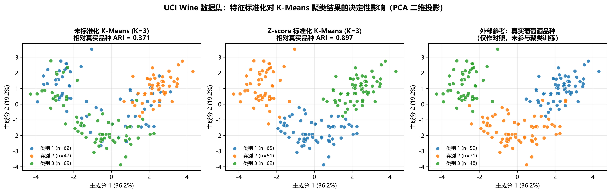
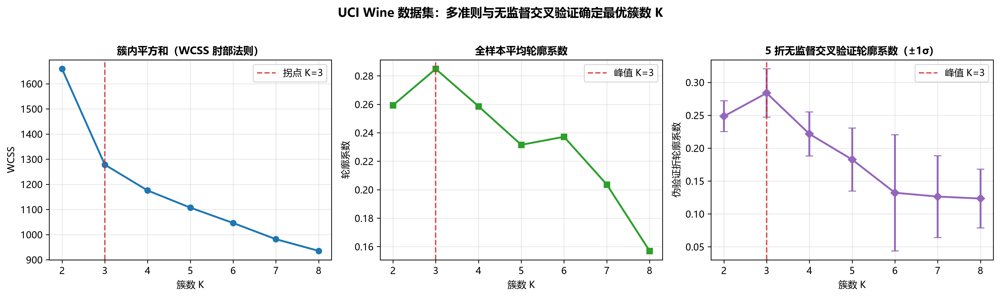
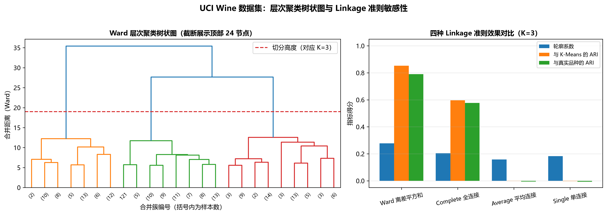
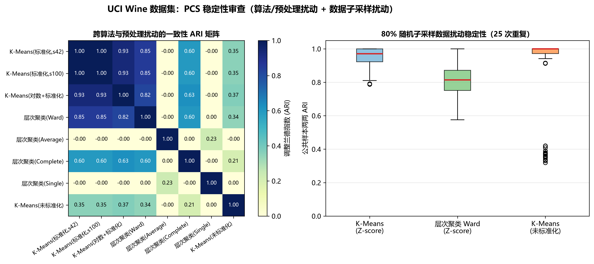
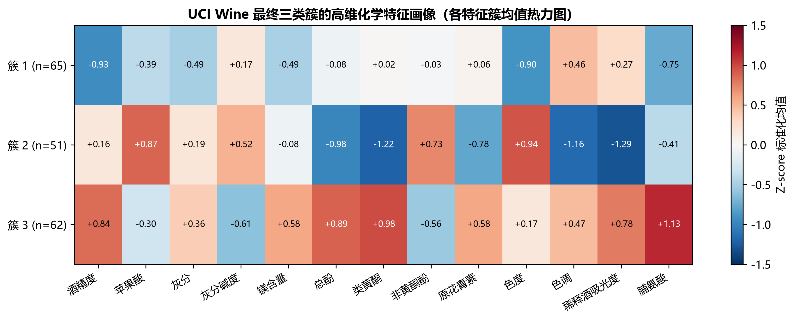
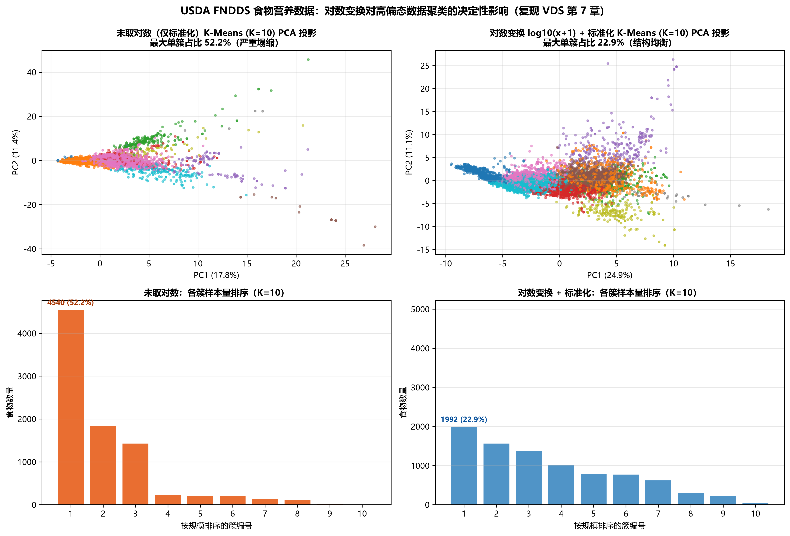
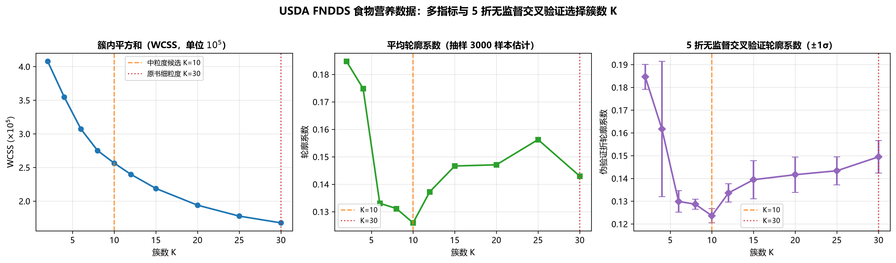
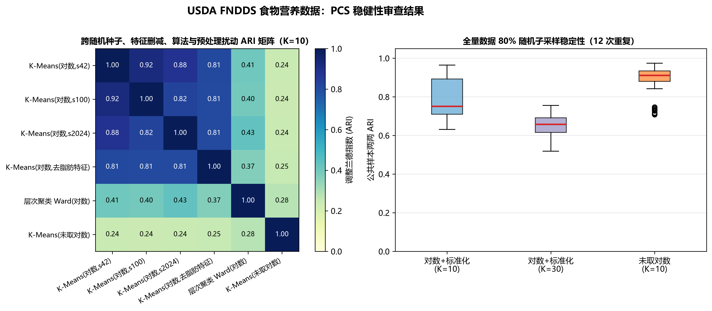
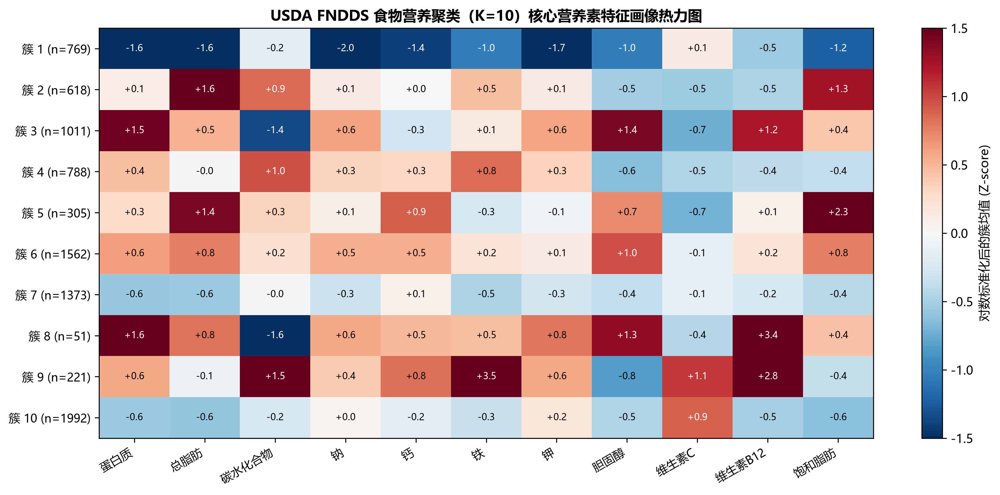

# 聚类分析与 PCS 稳健性审查实验报告（USDA 食物营养 & UCI Wine）

> **实验依据**：Bin Yu & Rebecca L. Barter, *Veridical Data Science* (2024) 第 7 章（Clustering）  
> **运行代码**：[`src/wine_clustering.py`](src/wine_clustering.py)、[`src/nutrition_clustering.py`](src/nutrition_clustering.py)、[`src/utils.py`](src/utils.py)  
> **核心目的**：通过一大（高维、严重右偏的真实食物营养数据）一小（低维、结构清晰且带外部品种对照的红酒理化数据）两个互补数据集，完整演示从**预处理判断 → 层次/K-Means 建模 → 无监督交叉验证选 $K$ → PCS 稳健性审查 → 高维特征画像**的端到端可信聚类流程。

---

## 一、双数据集实验总览与互补定位

| 对比维度 | 数据集 A：UCI Wine（葡萄酒理化指标） | 数据集 B：USDA FNDDS（原书食物营养数据） |
| :--- | :--- | :--- |
| **样本量 × 特征数** | $178 \times 13$（13 项化学成分） | $8,690 \times 57$（57 项营养素） |
| **核心数据痛点** | **量纲差异悬殊**（脯氨酸与非黄酮酚标准差相差 **2,530 倍**） | **极端右偏长尾分布**（原始特征偏度中位数高达 **9.69**） |
| **外部参考标签** | 有（3 种真实葡萄品种，仅用于事后对照，不参与训练） | 无（纯无监督探索，依靠原型食物与营养学常识解释） |
| **最适合展示的章节** | 7.1–7.3（标准化与 Linkage）、7.6（RI vs ARI）、7.7（CV 选 $K$ 精准命中） | 7.3（对数变换的决定性作用）、7.4（原型抽样）、7.8–7.9（高维 PCS 审查） |

---

## 二、实验一：UCI Wine 数据集（标准对照与基础原理验证）

### 1. 预处理判断（Judgment Call）：特征标准化的决定性影响
UCI Wine 的 13 个特征中，`脯氨酸（proline）` 的数值在数百到上千量级，而 `非黄酮酚` 在 $0.1 \sim 0.6$ 量级，标准差之比高达 **2,530 倍**。

| 预处理方案（K-Means, $K=3$） | 轮廓系数（所处空间） | 普通 Rand Index（对真实品种） | **调整兰德指数 ARI（对真实品种）** | 各簇样本量 |
| :--- | :---: | :---: | :---: | :---: |
| **未标准化原始数据** | **0.571**（虚假偏高！） | 0.719（基准虚高！） | **0.371** | [62, 47, 69] |
| **Z-score 标准化** | 0.285 | 0.954 | **0.897** | [65, 51, 62] |
| **$\log(1+x)$ + Z-score** | 0.307 | 0.940 | **0.865** | [52, 63, 63] |

> **关键建模洞察（极适合课堂强调）**：
> 1. **警惕“跨空间比较轮廓系数”的陷阱**：未标准化数据的轮廓系数高达 `0.571`，远超标准化后的 `0.285`——这是因为欧氏距离被单一变量 `脯氨酸` 主导，数据退化为近似一维分段，几何上看起来很“紧”，但完全丢失了其余 12 个化学特征的信息（真实 ARI 仅 `0.371`）！
> 2. **为什么必须用 ARI 而非普通 RI**：未标准化聚类其实分得很差，但普通 RI 仍高达 `0.719`，极易误导初学者；扣除随机期望后的 ARI（`0.371` vs `0.897`）才诚实反映了真实差距。

### 2. 科学选择簇数 $K$：肘部法则、轮廓系数与 5 折无监督交叉验证（7.5 & 7.7）
在标准化数据上扫描 $K = 2 \sim 8$：
* **WCSS 肘部法则**：在 $K=3$ 处出现明显折弯（$1658.8 \to 1277.9 \to 1175.4$）；
* **全样本轮廓系数**：在 $K=3$ 达到全局峰值 **0.285**；
* **5 折无监督交叉验证（VDS 7.7.1）**：在伪验证折上，$K=3$ 同样达到全局峰值 **0.284 ± 0.037**，且 $K \ge 4$ 后验证得分断崖式下跌（$K=4$ 降至 `0.222`，$K=6$ 降至 `0.132`），从**可预测性（Predictability）**角度严格锁定了 $K=3$。

### 3. 层次聚类与四种 Linkage 准则对比（7.2）

| Linkage 准则（Z-score, $K=3$） | 轮廓系数 | 与 K-Means 的 ARI | 与真实品种的 ARI | 各簇样本量 | 现象诊断 |
| :--- | :---: | :---: | :---: | :---: | :--- |
| **Ward（离差平方和）** | **0.277** | **0.853** | **0.790** | [58, 56, 64] | 均衡紧凑，与 K-Means 高度一致 |
| **Complete（全连接）** | 0.204 | 0.596 | 0.577 | [69, 58, 51] | 中等表现 |
| **Average（平均连接）** | 0.158 | -0.002 | -0.005 | **[174, 1, 3]** | 极端失衡，孤立离群点单独成簇 |
| **Single（单连接）** | 0.183 | -0.003 | -0.007 | **[174, 3, 1]** | 典型**“链式效应（Chaining）”** |

### 4. PCS 稳健性审查与高维特征画像（7.4 & 7.8）
* **跨算法/预处理扰动 ARI**：
  * 随机种子扰动（`seed=42` vs `seed=100`）：**ARI = 1.000**（完全收敛到同一稳定解）；
  * 温和变换扰动（Z-score vs Log1p+Z-score）：**ARI = 0.931**（极高稳健性）；
  * 跨算法扰动（K-Means vs Ward 层次聚类）：**ARI = 0.853**（不同算法独立印证同一结构）；
  * 致命失误扰动（标准化 vs 未标准化 / Single linkage）：**ARI = 0.354 / -0.003**。
* **80% 随机子采样数据扰动（25 次重复）**：
  * 标准化 K-Means 公共样本两两 **ARI = 0.954 ± 0.047**（极其稳健）；
  * 标准化 Ward 层次聚类 **ARI = 0.809 ± 0.087**；
  * 未标准化 K-Means 波动显著放大（标准差 `0.169`，为标准化 K-Means 的 **3.6 倍**）。

* **高维化学画像解读（7.4 节）**：
  * **簇 1（n=65）**：低酒精度（$-0.93$）、低色度（$-0.90$）、低脯氨酸（$-0.75$）、高色调（$+0.46$）→ 清爽淡雅型葡萄酒；
  * **簇 2（n=51）**：高色度（$+0.94$）、高苹果酸（$+0.87$）、低类黄酮（$-1.22$）、低稀释酒吸光度（$-1.29$）→ 浓郁高酸低酚型；
  * **簇 3（n=62）**：高脯氨酸（$+1.13$）、高类黄酮（$+0.98$）、高总酚（$+0.89$）→ 醇厚高酚饱满型。

---

## 三、实验二：USDA FNDDS 食物营养数据集（完整复现原书第 7 章）

严格按照原书官方仓库 [`Yu-Group/vds-book-supplementary`](https://github.com/Yu-Group/vds-book-supplementary) 的 `clean_food_data.py` 与 `preprocess_food_data.py` 清洗逻辑，从 USDA FNDDS 膳食调查数据中整理出 **8,690 种食物 × 57 项营养素**。

### 1. 复现原书核心发现：对数变换如何拯救严重右偏数据（7.3 & 7.8）
食物营养素呈极端右偏长尾分布：原始特征的偏度中位数高达 **9.69**，经过 $\log_{10}(x + 1)$ 变换后，偏度中位数大幅降至 **1.85**。对比“仅标准化（未取对数）”与“$\log_{10}(x+1)$ + 标准化”的 K-Means 结果：

| 指标 | 未取对数（仅 Z-score） | **$\log_{10}(x+1)$ + Z-score** | 结论 |
| :--- | :---: | :---: | :--- |
| **$K=10$ 最大单簇占比** | **52.2%**（4,540 / 8,690 种食物！） | **22.9%**（1,992 种） | 未取对数时**超过一半食物塌缩进同一巨型簇**，完美复现原书现象！ |
| **$K=10$ 最小簇样本数** | 仅 **4 种**（极端离群食物霸占小簇） | **51 种**（纯净的深海鱼类簇） | 对数变换让小簇也具备清晰语义 |
| **$K=30$ 最大单簇占比** | **41.6%**（前 3 大簇合计占 **64.7%**） | **7.0%**（前 3 大簇合计占 **19.4%**） | 细粒度下差距更悬殊 |
| **两种预处理划分的 ARI** | $K=10$ 时 ARI = **0.266**；$K=30$ 时 ARI = **0.171** | — | 证明**对数变换是最高敏感度的关键判断** |

### 2. 复杂真实高维数据上的 $K$ 值选择（7.5 & 7.7）
在 57 维真实食物数据上扫描 $K \in \{2, 4, 6, 8, 10, 12, 15, 20, 25, 30\}$：
* 与 UCI Wine 这种“教科书级 3 团块”不同，真实食物营养数据是**连续与多尺度嵌套**的：WCSS 呈平滑下降趋势，平均轮廓系数和 5 折无监督交叉验证轮廓系数在 $K=2$ 时偏高（`0.185`，但仅分两类毫无膳食指导意义），随后在 $K=10 \sim 30$ 区间内**伪验证折轮廓系数稳步回升至 `0.149 ± 0.007`**，且验证折平均平方距离持续下降（从 `46.99` 降至 `19.71`）。
* 这正好印证了 VDS 第 7.7 节的深刻哲学：**面对复杂真实数据，绝不能机械地取轮廓系数最大值的 $K=2$，而必须在交叉验证确认泛化结构稳定后，结合领域粒度选择 $K$**（例如宏观展示用 $K=10$，精细营养分类学用原书的 $K=30$）。

### 3. PCS 稳健性审查（7.8 节）
在 3,000 固定评估子样本（$K=10$）上进行跨扰动 ARI 检验，并在全量 8,690 种食物上进行 12 次 80% 随机子采样检验：
* **随机初始化扰动（seed 42 vs 100 / 2024）**：ARI = **0.919 / 0.881**（高度稳定）；
* **特征删减扰动（复现原书 `remove_fat=True`，删去总脂肪列）**：ARI = **0.810**（即使去掉核心宏量营养素，整体营养分群结构依然稳健！）；
* **算法扰动（K-Means vs Ward 层次聚类）**：ARI = **0.406**（中等一致，说明 57 维高维食物边界存在交叉，报告结论时应强调核心稳定类群而非绝对硬边界）；
* **预处理扰动（对数变换 vs 未取对数）**：ARI = **0.240**（再次确认预处理决定成败）；
* **80% 随机子采样稳定性**：对数变换 $K=10$ 平均 ARI = **0.790 ± 0.099**；$K=30$ 时平均 ARI = **0.650 ± 0.053**（随粒度变细，稳定性自然略有下降，但仍显著高于随机基准 0）。
  * *有趣细节*：未取对数 $K=10$ 的子采样 ARI 反而高达 `0.887`——为什么？因为超过一半样本永远被“锁死”在同一个巨型垃圾簇里！这给同学们上了一堂极佳的课：**高稳定性必须建立在“有意义的聚类结构”之上（Stability ≠ Meaningfulness）**。

### 4. 高维特征画像与代表食物原型抽样（7.4 & 7.9）
按照原书 7.4.1 节，提取每个簇离质心最近的原型食物（Prototypes），无需任何人工标签，算法自动还原出清晰的营养学类群：

| 簇编号 | 样本量 | 离质心最近的原型食物（原文名称） | 营养特征与自动识别的现实主题 |
| :--- | :---: | :--- | :--- |
| **簇 1** | 769 | Applesauce with other fruits; Pear nectar | 高水分、高糖、低脂低蛋白 → **果泥/果汁甜饮类** |
| **簇 2** | 618 | Cake/cupcake with icing; Peanut butter cookie | 高碳水、高糖、高脂肪 → **蛋糕与高脂曲奇甜点** |
| **簇 3** | 1,011 | Fried turkey; Salami; Adobo with rice | 高蛋白、高胆固醇、高维生素 B12、高钠 → **高蛋白肉类主菜** |
| **簇 4** | 788 | English muffin (oat bran); Oatmeal bread/roll | 高碳水、高膳食纤维、高铁 → **全谷物/燕麦烘焙主食** |
| **簇 5** | 305 | Grilled cheese sandwich; Ham & cheese croissant | 高饱和脂肪、高钙、高钠 → **奶酪/乳脂三明治与高脂烘焙** |
| **簇 6** | 1,562 | Ravioli with cream sauce; Chicken a la king | 营养均衡偏高脂高钠 → **含酱汁的复合冷冻/正餐** |
| **簇 7** | 1,373 | Creamed onions; Cream of leek soup | 高水分、中等蔬菜营养 → **奶油浓汤与烹调蔬菜** |
| **簇 8** | 51 | Mackerel (pickled); Barracuda (baked/steamed) | 极高蛋白、高维生素 B12、零碳水零纤维 → **深海鱼/海鲜类（极其纯净！）** |
| **簇 9** | 221 | General Mills Cheerios; Frosted oat cereal | 极高碳水、高铁、高维生素强化 → **强化早餐谷物麦片** |
| **簇 10** | 1,992 | Broccoli with mushroom sauce; Peas | 高膳食纤维、高维生素 A/C、低胆固醇 → **绿叶/豆类蔬菜** |

---

## 四、双数据集实验核心结论对照（可直接用于汇报总结）

1. **没有放之四海而皆准的预处理，但预处理往往决定成败**：UCI Wine 证明了**量纲标准化**的必要性（ARI `0.371 → 0.897`）；USDA FNDDS 证明了面对严重右偏数据时**对数变换**的必要性（最大单簇塌缩率 `52.2% → 22.9%`）。
2. **警惕“虚假高分”的双重陷阱**：
   - 未标准化 Wine 的**轮廓系数（0.571）**与**普通 RI（0.719）**虚假偏高；
   - 未取对数 FNDDS 的**子采样 ARI（0.887）**因为半数样本塌缩进同一个巨型簇而虚假稳定。
   - **破局之道**：永远结合**多维指标（ARI + CV 轮廓系数）+ 簇大小分布检查 + 原型抽样领域审查**。
3. **从“教科书数据”到“真实世界数据”的认知跃迁**：UCI Wine 上所有指标一致指向 $K=3$；而在真实 57 维食物数据上，没有唯一“上帝指定的 $K$”，必须在 **PCS 稳健性** 与 **领域解释粒度** 之间做出透明、有理有据的工程权衡。
